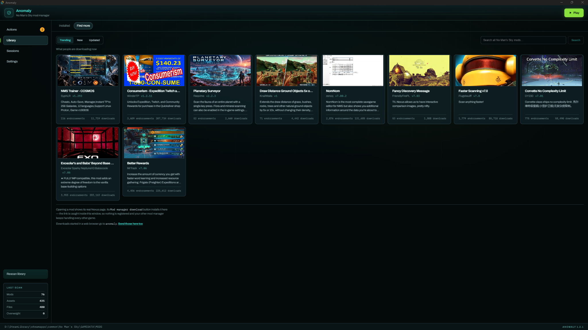
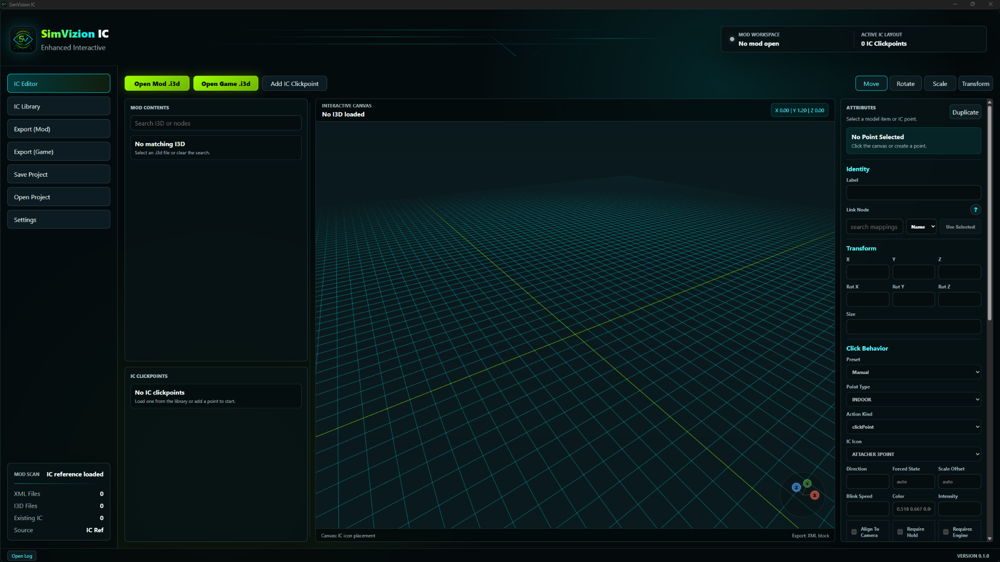
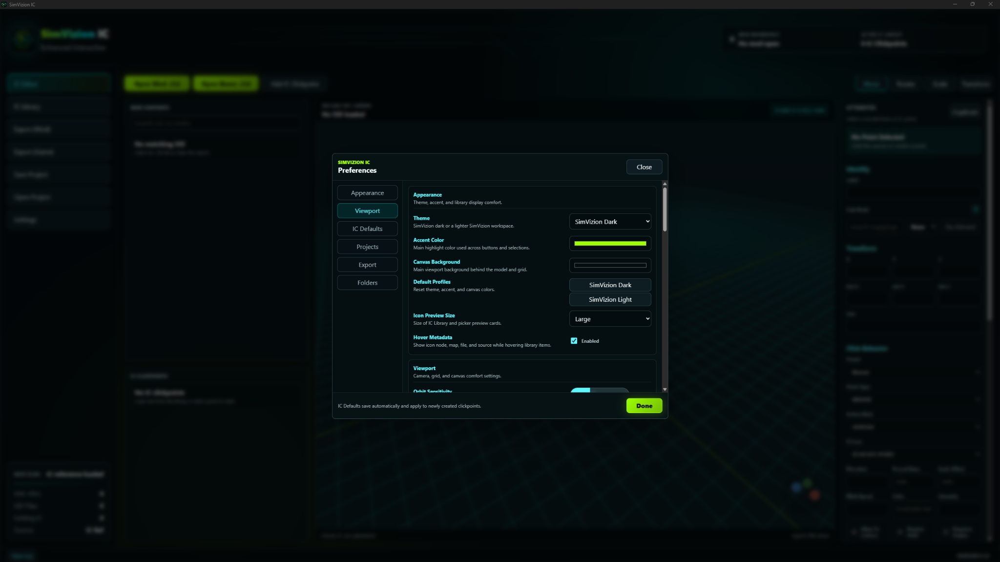

# SimVizion visual reference — family resemblance, not uniformity

The following images are **user-provided visual references**, not required application templates. The SimVizion IC screenshots take priority for visual character; the other screenshot provides secondary guidance. Their individual layouts, content and workflow are not standards to reproduce.

## Supplied visual references

## Additional supplied reference

> **Important:** Screenshot ordering and project names should be verified against the supplied images when presenting these externally. Regardless of ordering, **do not copy the reference screen arrangement** into unrelated projects.

## What to transfer

- Deep teal-black background and subtle panel contrast; near-white body text.
- Defined, precise controls with restrained lime action/on accents and cyan navigation/focus/selection.
- Compact typography, balanced spacing, light structural borders, and recessed input fields.
- A purposeful layout optimized for each application's actual workflow.

## Anti-patterns

- A generic framework theme with a lime button pasted into it.
- The same three-panel editor arrangement forced onto a simple utility or dashboard.
- Excess cyan text, green numbers everywhere, unnecessary glow, heavy shadows, or oversized rounding.
- Deeply nested full bordered boxes merely to organize related fields.
- Collapsing or hiding functionality to make a screen resemble the references.

The canonical written specifications, not screenshot pixel measurements, determine the final component styles.

## v1.3 visual-confidence review

The approved aesthetic is **crisp and confident**, not uniformly muted. Evaluate strong readable primary content, meaningful bright-lime featured headline values, readable descriptions, equal prominence for equally important peer categories, and balanced window utilization. A unified intermediate card surface can give a content-heavy interface more presence without adding nested borders or selected-state coloration. The supplied screenshots are identity references, not mandatory layout templates.
