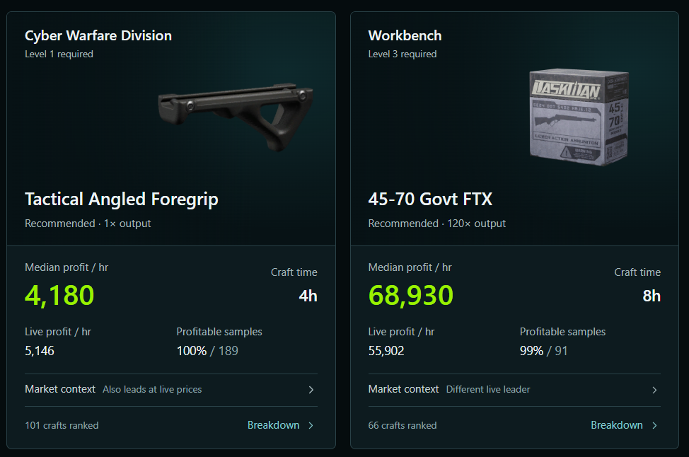
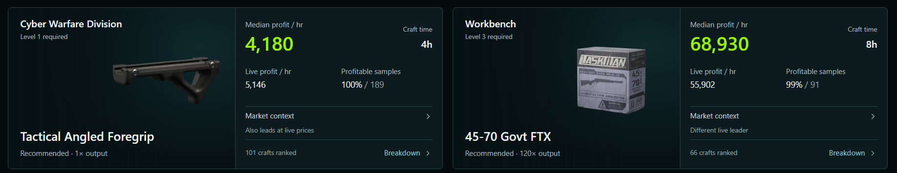
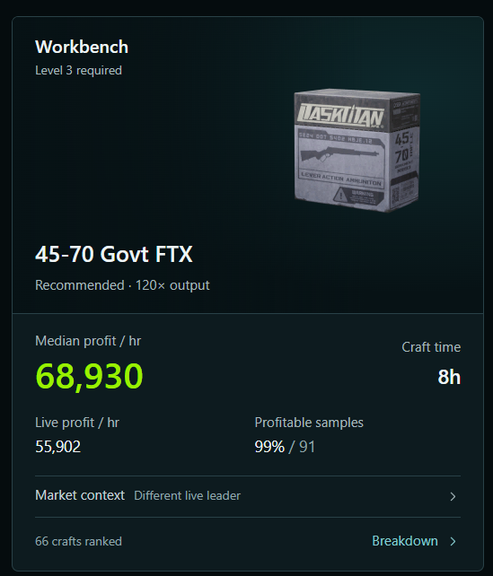
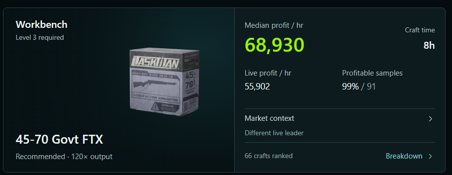

# SimVizion visual reference — family resemblance, not uniformity

The following images are **user-provided visual references**, not required application templates. The SimVizion IC screenshots take priority for visual character; the other screenshot provides secondary guidance. Their individual layouts, content and workflow are not standards to reproduce.

## Supplied visual references

## Additional supplied reference

> **Important:** Screenshot ordering and project names should be verified against the supplied images when presenting these externally. Regardless of ordering, **do not copy the reference screen arrangement** into unrelated projects.

## What to transfer

- Deep teal-black background and subtle panel contrast; near-white body text.
- Defined, precise controls with restrained lime action/on accents and cyan navigation/focus/selection.
- Compact typography, balanced spacing, light structural borders, and recessed input fields.
- A purposeful layout optimized for each application's actual workflow.

## Anti-patterns

- A generic framework theme with a lime button pasted into it.
- The same three-panel editor arrangement forced onto a simple utility or dashboard.
- Excess cyan text, green numbers everywhere, unnecessary glow, heavy shadows, or oversized rounding.
- Deeply nested full bordered boxes merely to organize related fields.
- Collapsing or hiding functionality to make a screen resemble the references.

The canonical written specifications, not screenshot pixel measurements, determine the final component styles.

## v1.3 visual-confidence review

The approved aesthetic is **crisp and confident**, not uniformly muted. Evaluate strong readable primary content, meaningful bright-lime featured headline values, readable descriptions, equal prominence for equally important peer categories, and balanced window utilization. A unified intermediate card surface can give a content-heavy interface more presence without adding nested borders or selected-state coloration. The supplied screenshots are identity references, not mandatory layout templates.

## Inspect the images, then transfer the relationships

Open each applicable image before using it for visual comparison. If access is unavailable, state that limitation. These annotations describe visible relationships rather than exact CSS or required layouts.

- **Reference 1 — Anomaly mod catalog:** the compact identity header leaves room for browsing. Repeated image frames, card boundaries and aligned text establish a coherent catalog. Artwork carries much of its character. Transfer framing and hierarchy; do not reproduce the mod catalog or its exact grid. Secondary to the IC identity references.
- **Reference 2 — SimVizion IC editor:** emblem backlighting, teal header shading and fine linework establish identity above quiet working panels. Lime actions are conspicuous; cyan defines context. The central perspective grid is a functional 3D workspace, not a background motif for other products. Transfer depth, boundaries, action hierarchy and branding; choose the workspace for the new task.
- **Reference 3 — SimVizion IC preferences:** a crisp foreground dialog separates from a dimmed, blurred application. Navigation, grouped settings and a clear primary completion action make the dialog readable. Transfer layering and control relationships; blur is optional and must have a usable fallback.

References establish visual intent, not automatic approval of every depicted state, text size or accent. Canonical accessibility and interaction rules still apply. Role-specific atmospheric treatments are defined in `references/identity-composition.md`. For a dashboard composition without a viewport, see `examples/composition-review.md`.

## DFTracker responsive cards — approved composition lessons (v1.5)

The user-reviewed DFTracker wide and narrow card designs inform these principles: cohesive identity and analytical regions, subtle sectional tonal depth, a quiet separator, intentionally paired near-white item identity and lime featured metric, balanced framing of differently shaped product imagery, aligned peer-card statistics, and side-by-side-to-stacked responsive reflow. These are **transferable relationships, not a mandatory card template**. Preserve useful natural colors in item thumbnails. The original SimVizion IC references above remain the primary family-identity examples. The bundled screenshots below illustrate these relationships. Inspect the images directly when using them for visual comparison.

## DFTracker visual examples — v1.5

### Equivalent peer cards

The same cards reflow from stacked identity/data regions to side-by-side sections. Compare alignment, subdued teal identity-region depth, natural artwork proportions, quiet dividers, and the near-white item title paired with a prominent lime metric. These are examples of relationships, not compulsory layouts.

### Single-card layout

The side-by-side and stacked examples illustrate how one cohesive outer card can change orientation without introducing nested panels.
